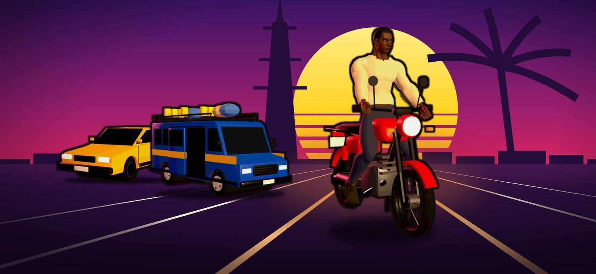
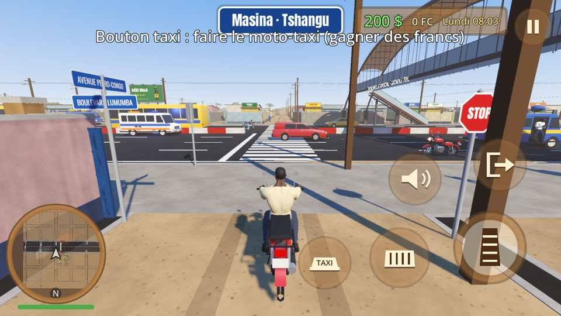
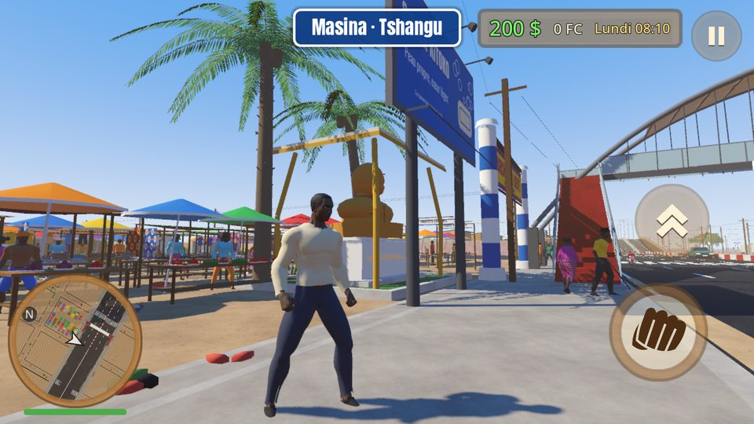
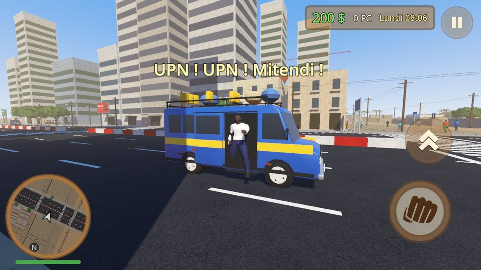
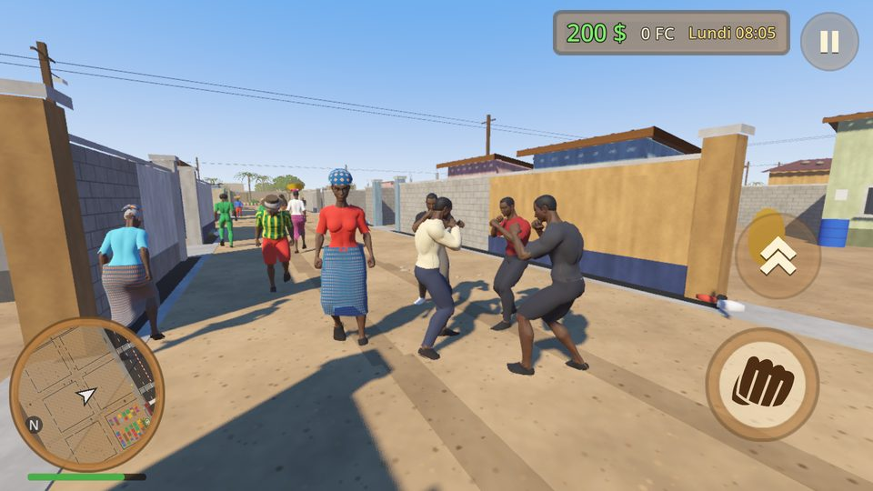
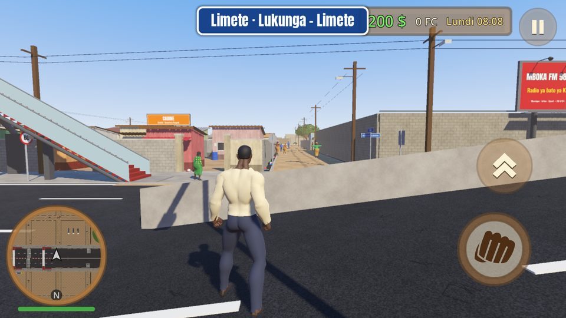
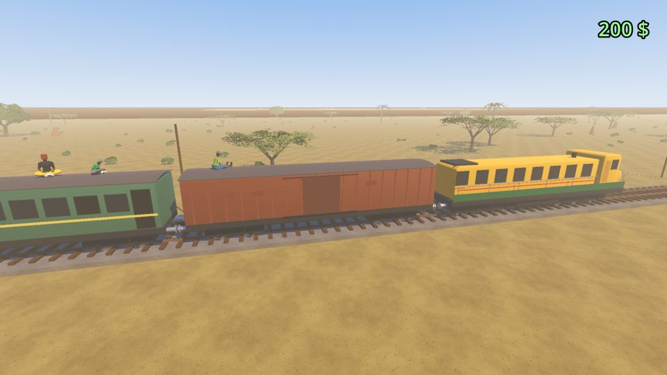

# Mwaka Mboka 1 — de Mbuji-Mayi à Kinshasa

## Un monde ouvert 100 % congolais

Kaba quitte Mbuji-Mayi avec un diplôme, dix dollars et l'adresse d'un oncle. Direction Kinshasa : 135 km de piste en camion, le train de Mwene-Ditu, la baleinière d'Ilebo… et la capitale, où même ton ombre peut te voler.

**Mwaka Mboka 1** est un jeu d'action en monde ouvert, à la troisième personne, entièrement congolais : les quartiers, les langues, les métiers, les embouteillages et la débrouille. Bientôt disponible sur iPhone, iPad et Android.

| | | |
|---|---|---|
|  |  |  |
|  |  |  |

## Une ville vivante

Le boulevard Lumumba d'un bout à l'autre : Masina, Kingabwa, Limete, Matonge, Gombe, Kingasani, l'aéroport de N'djili. Le marché de la Liberté, l'Échangeur de Limete, le pont Matete, les passerelles. Jour et nuit, délestage, pluie, rues inondées, vendeurs ambulants et receveurs qui crient leur destination.

## Débrouille-toi

Moto-taxi, taxi et taxi-bus : les clients montent, discutent le prix et te disent « malembe ! » si tu roules trop vite. Vends des unités, change tes dollars chez le cambiste, conduis des wewa, des taxis et des 207.

## Une histoire en cinq actes

Le prologue à Mbuji-Mayi puis cinq actes à Kinshasa : 36 missions, et des choix qui comptent — payer ou refuser, mentir ou dire la vérité, se battre ou s'écraser.

## Dans ta langue

Textes et voix en français, anglais, lingala, tshiluba, swahili et kikongo. Dans les véhicules, la radio joue rumba, sebene, ndombolo, soukous et mutuashi.

Le jeu fonctionne hors ligne, sans publicité ni achat intégré. Public : 16 ans et plus.

---

© 2026 Gedeon Mutshipayi. Personnages, partis, entreprises et radios fictifs.
[Assistance](ASSISTANCE.md) · [Politique de confidentialité](CONFIDENTIALITE.md)
